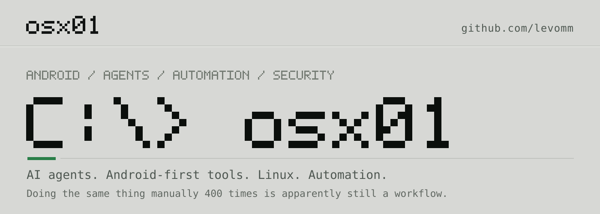
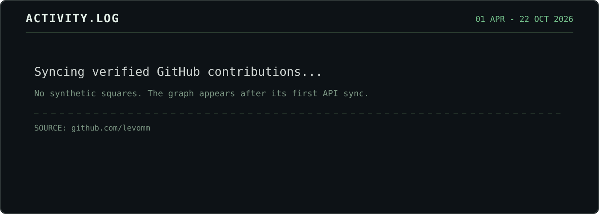
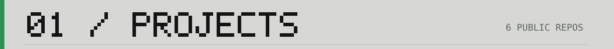
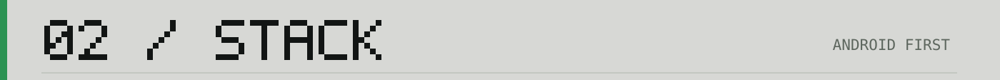
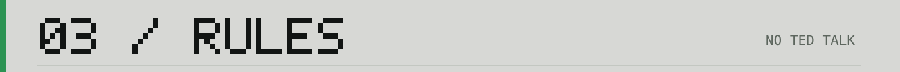

<!-- OSX01 / LEVOMM RETRO PIXEL PROFILE -->

 

ACTIVITY.LOG | 01 APR - OCT 2026 | data: GitHub contribution calendar | last synced date is shown above

 

### About

<pre>
C:\> whoami

levomm
AI agents / Android-first tooling / automation / Linux / security.

I build systems that inspect state, use tools and verify the result.
Because pressing the same button 400 times apparently counts as a process.
</pre>

<table>
  <tr>
    <td width="50%" valign="top">
      <b><a href="https://github.com/levomm/SeekerClaw">SeekerClaw</a></b> 
      Android agent runtime, MCP tooling and Telegram/Discord control. 
      <code>Kotlin / Compose / Node.js / MCP</code>
    </td>
    <td width="50%" valign="top">
      <b><a href="https://github.com/levomm/claw-bridge">claw-bridge</a></b> 
      Android-first agent control for Linux machines and approval-driven operations. 
      <code>Android / Agents / Remote control</code>
    </td>
  </tr>
  <tr>
    <td width="50%" valign="top">
      <b><a href="https://github.com/levomm/pocketport">PocketPort</a></b> 
      Making desktop-first developer repositories usable in Termux. 
      <code>Python / Termux / Repo analysis</code>
    </td>
    <td width="50%" valign="top">
      <b><a href="https://github.com/levomm/osx01">osx01</a></b> 
      Local coding agent with repo-aware tools and Ollama/API integrations. 
      <code>Python / Local AI / Tool calling</code>
    </td>
  </tr>
  <tr>
    <td width="50%" valign="top">
      <b><a href="https://github.com/levomm/DNB_CHOPSHOP">DNB CHOPSHOP</a></b> 
      Browser workstation for slicing, sequencing and sound design. 
      <code>React / TypeScript / Web Audio</code>
    </td>
    <td width="50%" valign="top">
      <b><a href="https://github.com/levomm/raw-tag">RAW TAG</a></b> 
      Drawing-first graffiti lab with AI-assisted transformations. 
      <code>React / TypeScript / AI</code>
    </td>
  </tr>
</table>

<pre>
PLATFORM   Android / Termux / Linux
LANGUAGES  Kotlin / Python / TypeScript / JavaScript
TOOLS      Git / GitHub Actions / Docker / SSH
AI         OpenAI / Ollama / MCP / Local runtimes
WORK       Agents / Automation / Security / Data pipelines
</pre>

<pre>
[workflow]
repeated_work   = automate
tool_results    = verify
risky_actions   = approval_required
shipping        = working_code_first
buzzwords       = /dev/null
</pre>

  A workflow with 37 manual steps is just a hobby with deadlines.

    

  <a href="https://github.com/levomm?tab=repositories"><b>github.com/levomm/repositories</b></a>

