<!-- LEVOMM / NEON TERMINAL PROFILE -->
<div align="center">
  

  <br />

  <a href="https://github.com/levomm?tab=repositories"></a>
  
  
  
</div>

---

### `root@levomm:~# whoami`

```console
> Builder of AI agents, Android-first tools and automation that actually executes.
> Working across Termux, Linux, APIs, self-hosted runtimes and security tooling.
> Less clicking. More systems that inspect state, act, verify and keep going.

[ PHILOSOPHY ]   TOOLS > TALK
[ CONTROL    ]   ANDROID IS NOT A COMPANION SCREEN
[ RUNTIME    ]   LOCAL FIRST, CLOUD WHEN IT EARNS ITS KEEP
[ SHIPPING   ]   BUILD -> BREAK -> VERIFY -> SHIP
```

### `root@levomm:~# ls -la ~/projects/`

<table>
  <tr>
    <td width="50%" valign="top">
      <h3><a href="https://github.com/levomm/SeekerClaw"><code>./SeekerClaw</code></a></h3>
      Android agent runtime with Telegram/Discord control, tool use, MCP and multi-provider AI.<br/><br/>
      <code>Kotlin</code> <code>Compose</code> <code>Node.js</code> <code>MCP</code>
    </td>
    <td width="50%" valign="top">
      <h3><a href="https://github.com/levomm/claw-bridge"><code>./claw-bridge</code></a></h3>
      Phone-first control plane for AI agents, remote Linux machines and approval-driven execution.<br/><br/>
      <code>Android</code> <code>Agents</code> <code>SSH</code> <code>Automation</code>
    </td>
  </tr>
  <tr>
    <td width="50%" valign="top">
      <h3><a href="https://github.com/levomm/pocketport"><code>./pocketport</code></a></h3>
      Turns desktop-first repositories into workable Android / Termux environments.<br/><br/>
      <code>Python</code> <code>Termux</code> <code>Repository tooling</code>
    </td>
    <td width="50%" valign="top">
      <h3><a href="https://github.com/levomm/osx01"><code>./osx01</code></a></h3>
      Local coding agent with project search, file edits and command execution via Ollama and compatible APIs.<br/><br/>
      <code>Python</code> <code>Local AI</code> <code>Tool calling</code>
    </td>
  </tr>
  <tr>
    <td width="50%" valign="top">
      <h3><a href="https://github.com/levomm/DNB_CHOPSHOP"><code>./DNB_CHOPSHOP</code></a></h3>
      Browser-based drum &amp; bass workstation: slicing, sequencing, variations and export.<br/><br/>
      <code>React</code> <code>TypeScript</code> <code>Web Audio</code>
    </td>
    <td width="50%" valign="top">
      <h3><a href="https://github.com/levomm/raw-tag"><code>./raw-tag</code></a></h3>
      Sketch with your finger or stylus, then push it through AI-assisted street-art transformations.<br/><br/>
      <code>React</code> <code>TypeScript</code> <code>AI</code>
    </td>
  </tr>
</table>

### `root@levomm:~# cat ~/toolchain.env`

<div align="center">
  
  
  
  
  
  
  
  
  
  
  
</div>

### `root@levomm:~# tail -f /var/log/commits.log`

<div align="center">
  <a href="https://github.com/levomm?tab=overview">
    
  </a>
</div>

### `root@levomm:~# cat /etc/operating-rules`

```ini
[agent]
tools_required        = true
verify_result         = true
human_approval        = for_risky_actions

[workflow]
repeated_work         = automate
broken_systems        = diagnose_then_fix
mobile_first          = always
buzzwords             = /dev/null
```

---

<div align="center">

```text
root@levomm:~# ./build --no-fluff --verify
[████████████████████████████████] 100%
> WORKING SYSTEMS OR IT DIDN'T HAPPEN.
```

<a href="https://github.com/levomm?tab=repositories"></a>

</div>
